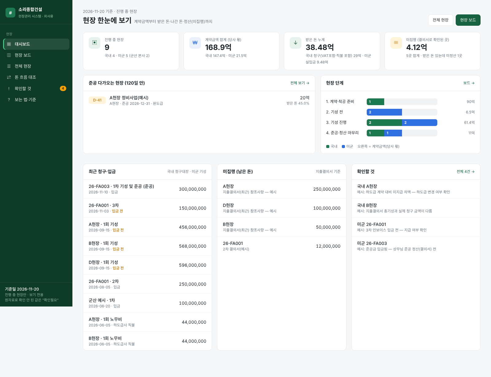
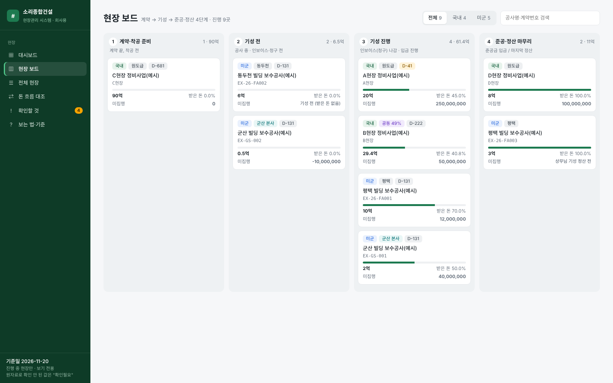
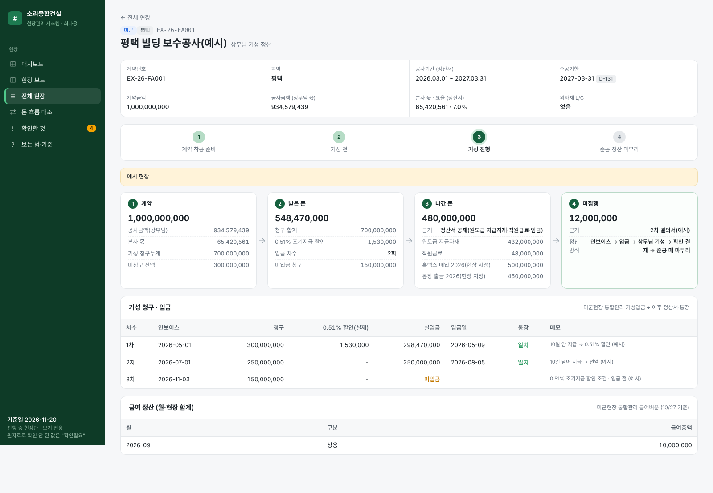
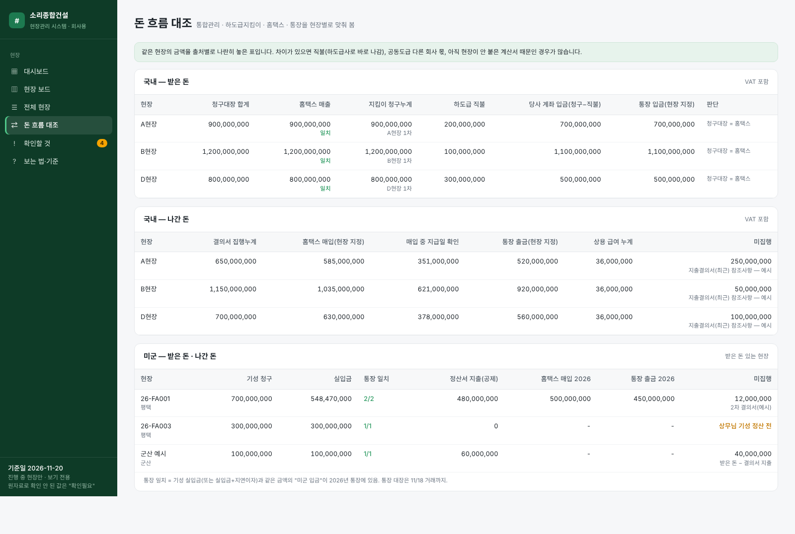

# 소리종합건설 현장관리 시스템

수주 이후 현장 하나하나의 **계약 → 받은 돈 → 나간 돈 → 정산(미집행)** 을 한 화면에서 보는 회사용 웹 화면입니다.
관리 담당자가 Claude와 함께 만들어 2026년 11월부터 실제로 쓰고 있습니다.

> **이 저장소의 데이터는 모두 가짜 예시입니다.** 현장명·금액·업체명·계약번호는 공개용으로 바꾼 값입니다.
> 실제 데이터는 회사 공유폴더의 엑셀에서 매일 다시 만들어 넣습니다.

## 바로 보기

`site/index.html` 을 내려받아 브라우저로 열면 예시 데이터로 화면이 열립니다. 서버가 필요 없는 파일 하나짜리 화면입니다.

| 대시보드 | 현장 보드 |
|---|---|
|  |  |

| 현장 상세 (미군) | 돈 흐름 대조 |
|---|---|
|  |  |

## 들어 있는 것

| 위치 | 내용 |
|---|---|
| `site/template.html` | 화면 틀 (HTML·CSS·JS 한 파일). `__DATA__` 자리에 데이터가 들어감 |
| `site/sample_data.json` | 가짜 예시 데이터 (국내 4곳, 미군 5곳) |
| `site/index.html` | 예시 데이터를 넣어 만든 완성 화면 |
| `site/make_page.py` | 데이터 + 틀 → `index.html` 만드는 스크립트 |
| `docs/업무현황.md` | 회사 관리 업무 전체 현황과 요청 사항 |
| `docs/업무규칙.md` | 화면 숫자를 만드는 업무 규칙 (미군 정산, 0.51% 조기지급 할인, 미집행 등) |
| `docs/데이터구조.md` | `data.json` 항목 설명과 원자료(엑셀) 위치 |
| `docs/지금_운영방식.md` | 지금 매일 어떻게 업데이트되는지, 한계 |

## 화면 메뉴

1. **대시보드**: 진행 현장 수, 계약금액 합계, 받은 돈, 미집행, 준공 임박 현장, 단계별 막대, 최근 청구·입금, 확인할 것
2. **현장 보드**: 1 계약·착공 준비 → 2 기성 전 → 3 기성 진행 → 4 준공·정산 마무리 (국내/미군 탭)
3. **전체 현장**: 현장 한 줄 = 계약 → 받은 돈 → 나간 돈 → 미집행 → 미청구 잔액
4. **현장 상세**: 계약·받은 돈·나간 돈·정산 4칸, 하도급지킴이, 홈택스·통장, 청구·입금 내역, 급여(월·현장 합계), 외자재
5. **돈 흐름 대조**: 같은 현장 금액을 통합관리·하도급지킴이·홈택스·통장 출처별로 나란히 비교
6. **확인할 것**: 원자료끼리 안 맞거나 원자료가 없는 것
7. **보는 법·기준**

## 업그레이드에서 원하는 것 (요약)

자세한 내용은 `docs/업무현황.md` 의 "요청 사항".

1. 현장 정보는 한 번만 입력하고 회사 양식(정산서·매입매출장·4대보험 정산내역·지출결의서·신용장 List)이 자동으로 따라오는 구조
2. 기성 서류·인보이스·세금계산서·통장·하도급지킴이 금액 자동 대조
3. 대표님 견적·제안 시스템(수주까지)과 이어지는 수주 이후 화면 (현장별 체크리스트 포함)
4. 로그인이 필요한 사이트(홈택스·하도급지킴이) 연동 방법
5. 여러 사람이 같이 써도 입력이 사라지지 않는 저장 구조 (엑셀 대신 DB 등)

## 지킬 것

- 원본 파일은 읽기만 하고 새 파일만 만든다
- 주민등록번호·계좌번호는 결과물에 넣지 않는다. 급여는 월·현장 합계로만
- 원자료로 확인 안 되는 값은 추측하지 않고 "확인필요"
